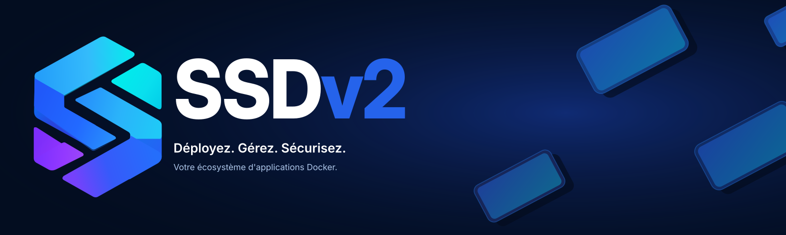

  

<h1 align="center">SSDv2</h1>

  <strong>Déployez. Gérez. Sécurisez.</strong> 
  Votre écosystème d'applications Docker.

  
  
  

  <a href="#découvrir-ssdv2">Découvrir</a> ·
  <a href="#fonctionnalités">Fonctionnalités</a> ·
  <a href="#bien-démarrer">Bien démarrer</a> ·
  <a href="#communauté-et-contributions">Communauté</a>

---

## Découvrir SSDv2

**SSDv2** est un projet open source conçu pour faciliter le déploiement et l'administration d'applications Docker sur un serveur.

Né sous le nom *Script Seedbox Docker*, le projet a évolué vers un écosystème d'applications que l'on peut installer, gérer et maintenir depuis un **menu en ligne de commande** ou une **interface Web**.

L'objectif reste le même : rendre l'administration de son serveur plus simple, tout en gardant la maîtrise de son environnement.

## Fonctionnalités

| | Ce que permet SSDv2 |
| :--- | :--- |
| **Applications** | Parcourir un catalogue d'applications et gérer leur installation ou leur suppression. |
| **Déploiement** | Automatiser la configuration et le déploiement des services Docker. |
| **Administration** | Utiliser le menu CLI ou l'interface Web pour piloter les opérations courantes. |
| **Maintenance** | Retrouver les conteneurs, volumes et entrées DNS associés aux applications gérées. |
| **Sécurité** | Gérer les accès et les données sensibles en s'appuyant sur les mécanismes prévus par le projet. |

> Pour aller plus loin : découvrez les [mécanismes internes de SSDv2](docs/mecanismes.md), notamment le cycle de vie des applications, les registres Docker et la gestion des invites sécurisées.

## Bien démarrer

La documentation officielle vous accompagne dans la préparation de votre serveur, l'installation et la configuration des applications.

**[Consulter le guide d'installation et la documentation →](https://projetssd.github.io/ssdv2_docs/)**

Avant de commencer, vérifiez les prérequis techniques et prenez connaissance des recommandations de sécurisation proposées dans la documentation.

## Documentation et ressources

| Ressource | Description |
| :--- | :--- |
| [Documentation officielle](https://projetssd.github.io/ssdv2_docs/) | Installation, configuration, applications et maintenance |
| [Mécanismes internes](docs/mecanismes.md) | Fonctionnement du déploiement, registres et sécurité |
| [Historique des changements](CHANGELOG) | Évolutions et corrections apportées au projet |
| [Charte graphique SSDv2](https://github.com/projetssd/branding) | Logos, couleurs et design system (accès selon les droits au dépôt) |

## Communauté et contributions

SSDv2 est un projet open source porté par sa communauté.

- **Échanger et demander de l'aide :** [rejoindre le Discord SSDv2](https://discord.com/invite/ZhWvKVmTuh).
- **Signaler un problème ou proposer une amélioration :** [ouvrir une issue](https://github.com/projetssd/ssdv2/issues).
- **Contribuer au code :** [consulter les pull requests](https://github.com/projetssd/ssdv2/pulls).

## Remerciements

Merci à **[JetBrains](https://www.jetbrains.com/)** pour les licences open source qui contribuent au développement de ce projet.

  &nbsp;&nbsp;
  &nbsp;
  &nbsp;
  

---

**Important :** SSDv2 est fourni à des fins d'expérimentation. Il appartient à chaque utilisateur de respecter la législation applicable, notamment les droits d'auteur. Pour vos essais, privilégiez les contenus libres de droits ou ceux pour lesquels vous disposez des autorisations nécessaires.

  SSDv2 · <a href="LICENCE.md">Licence GNU GPL v3</a> · <a href="https://projetssd.github.io/ssdv2_docs/">Documentation</a> · <a href="https://discord.com/invite/ZhWvKVmTuh">Discord</a>

